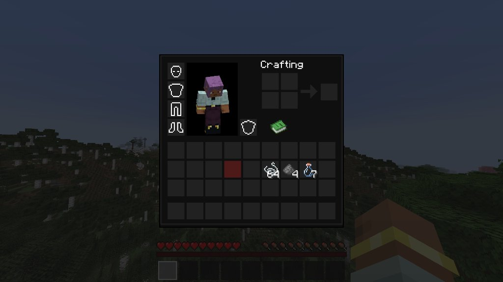
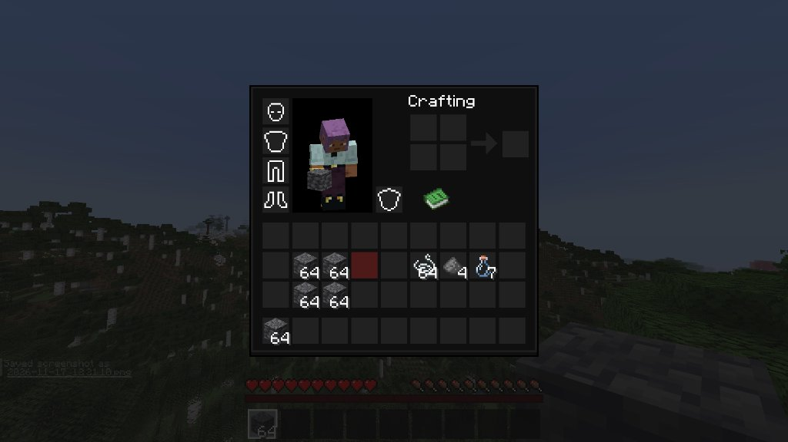

# Quick Trash

A lightweight, quality-of-life (QoL) Minecraft 1.20.1 mod (compatible with Forge 47.3.0+ and NeoForge 1.20.1).

## Showcase

**Hover over an item and press `D` to delete it instantly.**


**The item is immediately deleted — a "Lava hisses" sound plays as confirmation.**


**Hold `D` and drag your cursor across slots to delete multiple items in one smooth swipe.**




**Press `Z` to undo — the entire deleted batch is restored to your inventory at once.**


**All stacks from the undo step are returned, even if deleted by a swipe.**



**Items are restored back to exactly the type and stack size they were before deletion.**


---

## Features

1. **Swipe-to-Delete (No need for holding)**
   - **Default Key**: `D` (customizable in controls).
   - Works in containers as well (inventory, chest, shulker box, crafting table, etc.).
   - **Single Delete**: Hover over an item and press `D` to delete it instantly.
   - **Continuous Swipe**: **Hold down `D` and slide your cursor** across slots to continuously delete items in a fast, fluid motion.

2. **Delete All Matching Items (Shift + D)**
   - Hover over any item in your inventory or container and press **`Shift + D`**.
   - Instantly deletes **all items of the same type** in the current container (e.g., clear all cobblestone stacks at once).

3. **Undo Deletions (Recover Items)**
   - **Default Key**: `Z` (customizable in controls).
   - Each press of `Z` restores the **entire batch** of the last deletion:
     - If you deleted a stack of 64 eggs with `D`, pressing `Z` restores all 64 eggs.
     - If you deleted 5 stacks of cobblestone with `Shift + D`, pressing `Z` restores **all 5 stacks at once**!
   - Preserves enchantments, custom names, and NBT data.
   - Supports up to 64 consecutive undo steps.
   - Safely returns items to the player's inventory, or drops them at the player's feet if the inventory is full (never voids items).

4. **Smart Search Protection**
   - Automatically disables delete and undo shortcuts while typing in search boxes (e.g., recipe book search bar, JEI/REI search bars) to prevent accidental deletions.

5. **Full Survival & Creative Support**
   - Works consistently in both Survival and Creative modes.
   - Uses server-validated C2S network packets ensuring secure multiplayer synchronization (requires the mod on both client and server for multiplayer).

6. **Satisfying Audio Feedback**
   - Plays a crisp extinguish sound upon deleting items.
   - Plays an item pickup chime and displays an action-bar notification showing the restored item and quantity when undoing.

## Key Bindings

You can configure the key bindings anytime via:
**Options → Controls → Key Binds → Quick Trash**

| Action | Default Key |
|--------|-------------|
| Hold & Swipe to Delete | `D` |
| Delete All Matching Items | `Shift + D` |
| Undo Last Deletion | `Z` |

## Installation

1. Install **Minecraft Forge 1.20.1** (version 47.x).
2. Download the latest `quicktrash-x.x.x-1.20.1.jar` from the [Releases](../../releases) page.
3. Drop the `.jar` file into your `.minecraft/mods` folder.

> **Multiplayer Note**: Both the client and the server must have this mod installed for it to work in multiplayer.

## Building from Source

1. Open the project root folder in your IDE (Cursor, IntelliJ IDEA, VS Code, etc.).
2. Open the terminal and run:
   ```cmd
   .\gradlew.bat build
   ```
3. The compiled jar will be at `build/libs/quicktrash-1.0.0-1.20.1.jar`.

## License

Copyright (c) 2026 1hidomi. **All Rights Reserved**.

Redistribution, modification, and re-uploading of this mod or its source code are strictly prohibited without explicit written permission from the author. Modpack inclusion on CurseForge and Modrinth is permitted.
